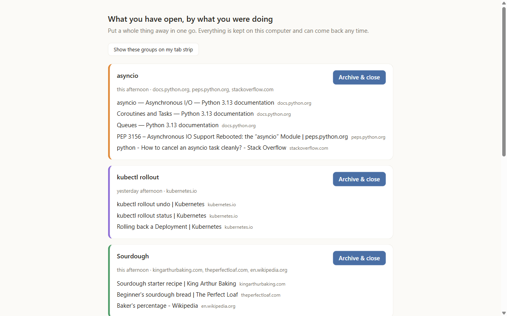
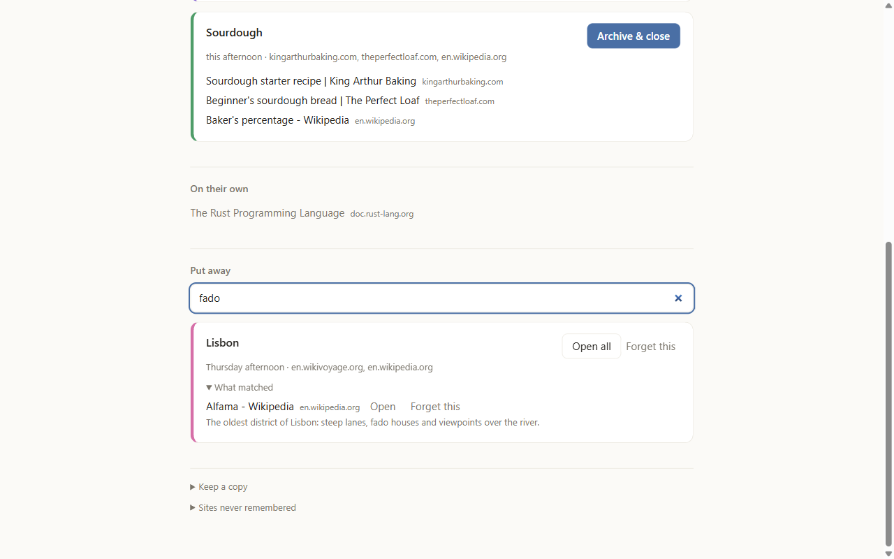

<h1 align="center">Tab Amnesty</h1>

<b>Close it, you'll still have it.</b>

A Chrome extension that remembers what your tabs were about, groups them by what you were
doing, and lets you put a whole project away in one click — kept, searchable, and back whenever
you want it. Everything stays on your computer.

<picture>
  <source media="(prefers-color-scheme: dark)" srcset="docs/images/sweep-dark.png">
  
</picture>

## Why

People with dozens of tabs open are rarely disorganised: closing a tab feels like losing it, so it
stays open
([Chang et al., CHI 2021](https://www.cmu.edu/news/stories/archives/2021/may/overcoming-tab-overload.html)).
Tab Amnesty makes closing safe. Before anything closes it writes down what each tab was, and it
gives everything back — in one click, by search, or as a file you keep.

## What it does

- **Groups tabs by what you were doing, not by topic.** Tabs you opened from one another, in one
  sitting, and switched between are one project, even across sites. Each group gets a name you'll
  recognise ("asyncio", "Lisbon"), from Chrome's on-device model when your Chrome has it and from
  the pages' own titles when it doesn't. You never have to name anything.
- **One button per group: Archive & close.** It saves every page — address, title, what the page
  said — and only then closes the tabs. Nothing closes unless you press it, one group at a time,
  and a tab holding a half-written message stays open.
- **Bring back** puts the whole group back on your tab strip, in its order, for a day — even after
  a restart. After that, **Open all** brings it back whenever you like.
- **Find anything you put away** by a word from its title, its text, its site, or the day.
- **Keep a copy:** everything you put away as one file that opens in any browser, and can be
  brought back in here or on another computer.
- **Forget anything:** *Forget this* on every group and every page, and a list of sites it never
  remembers.

<picture>
  <source media="(prefers-color-scheme: dark)" srcset="docs/images/search-dark.png">
  
</picture>

## Private by design

Everything Tab Amnesty records stays on your computer. It makes no network requests: no account,
no server, no analytics. It never runs in incognito windows, and mail, chat and search pages keep
no title or text. What it records, why, and what each permission is for: [PRIVACY.md](PRIVACY.md).
Tab Amnesty's use of this information complies with the Chrome Web Store User Data Policy,
including the Limited Use requirements.

## Install

**From a release** — Chrome, Edge or Brave, version 116 or later:

1. Download `tab-amnesty-<version>.zip` from
   [Releases](https://github.com/Makilesh/Chrome_tab_amnesty/releases) and unzip it somewhere
   you'll keep: Chrome runs the extension from that folder.
2. Open `chrome://extensions` (`edge://extensions`, `brave://extensions`), switch on
   **Developer mode**, click **Load unpacked** and choose the unzipped folder.
3. Pin Tab Amnesty from the puzzle-piece menu. Browse as you always do, and click its icon
   whenever you like.

To update, replace the folder's contents with the new zip's, then switch Tab Amnesty off and on
again in `chrome://extensions`. A Chrome Web Store listing is on its way.

**From source:** `npm ci && npm run build`, then load `dist/` the same way, and press **Reload** on
the extension after every rebuild.

## How it works

As you browse, a content script and a service worker note which tab opened which, when, what you
switch between, and a short digest of each page, in the extension's own storage. When you click
the icon, Tab Amnesty clusters your open tabs from those records — a deterministic Louvain over
lineage, timing, co-activation, strip position and page text, never by reading live tabs — names
each group and offers one action per group. The design rules it holds itself to are in
[CLAUDE.md](CLAUDE.md); the research behind it, and the measurement it still has to pass, are in
[docs/RESEARCH.md](docs/RESEARCH.md).

## Contributing

Issues and pull requests are welcome. `npm test` runs the unit tests. `npm run check` drives a real
Chrome for Testing through recording, grouping, putting away, a restart, bringing back, search and
copies (run `npm run check:setup` once first). More in [docs/RESEARCH.md](docs/RESEARCH.md).

## License

[MIT](LICENSE).
