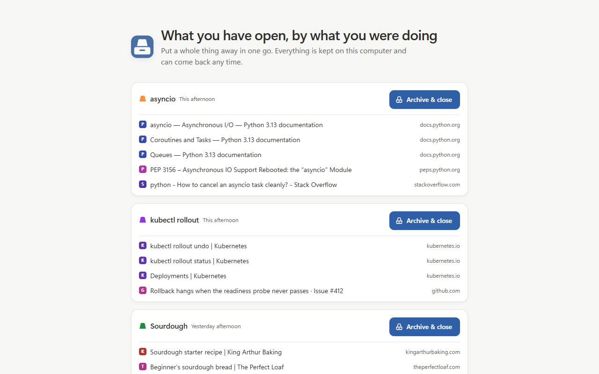
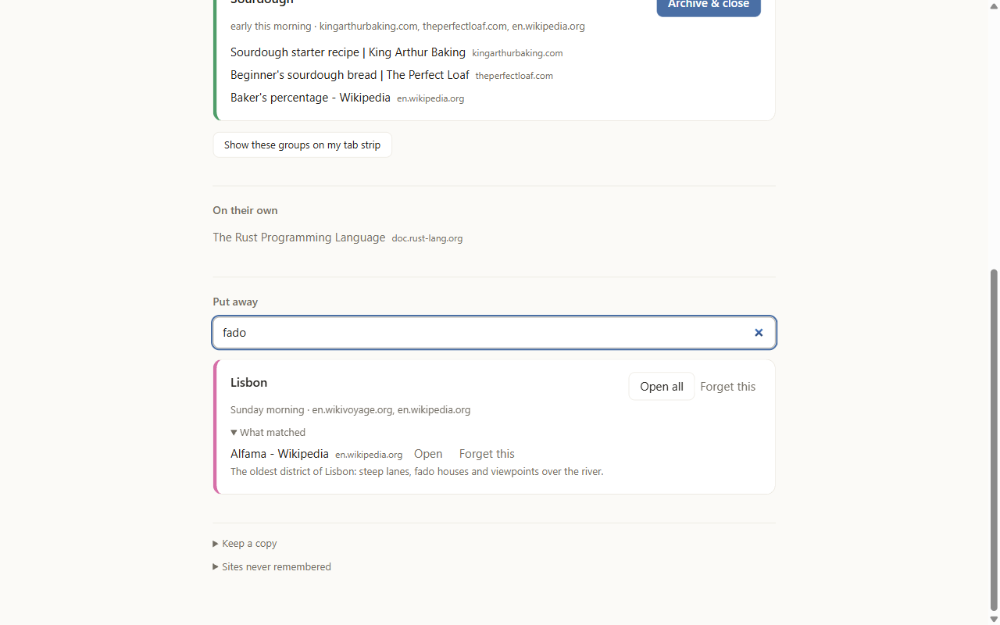

<h1 align="center">Tab Amnesty</h1>

<b>Close it, you'll still have it.</b>

  
  
  
  
  

A Chrome extension that remembers what your tabs were about, groups them by what you were
doing, and lets you put a whole project away in one click — kept, searchable, and back whenever
you want it. Everything stays on your computer.

<b>Status:</b> early (0.2.0). How well the grouping works is still being measured — <a href="docs/RESEARCH.md">how</a>.

<picture>
  <source media="(prefers-color-scheme: dark)" srcset="docs/images/sweep-dark.png">
  
</picture>

## Why

People with dozens of tabs open are rarely disorganised: closing a tab feels like losing it, so it
stays open
([Chang et al., CHI 2021](https://www.cmu.edu/news/stories/archives/2021/may/overcoming-tab-overload.html)).
Tab Amnesty makes closing safe. Before anything closes it writes down what each tab was, and it
gives everything back — in one click, by search, or as a file you keep. It is designed with ADHD in
mind: nothing closes unless you press a button, you never have to name or sort anything, and there
are no counts, streaks or reminders.

## What it does

- **Groups tabs by what you were doing, not by topic.** Tabs you opened from one another, in one
  sitting, and switched between are one project, even across sites. Each group gets a name you'll
  recognise ("asyncio", "Lisbon"), from Chrome's on-device model when your Chrome has it and from
  the pages' own titles when it doesn't. You never have to name anything.
- **One button per group: Archive & close.** It saves every page — address, title, what the page
  said — and only then closes the tabs. Nothing closes unless you press it, one group at a time,
  and a tab holding a half-written message stays open.
- **Bring back** puts the whole group back on your tab strip, in its order, for a day — even after
  a restart. After that, **Open all** brings it back whenever you like.
- **Find anything you put away** by a word from its title, its text, its site, or the day.
- **Or from the address bar:** type `ta`, press Tab, then a word. Pick a page to open it, or press
  Enter to see everything that matches.
- **Alt+Shift+K** (Option+Shift+K on a Mac) opens Tab Amnesty from any tab. Change it at
  `chrome://extensions/shortcuts`.
- **Keep a copy:** everything you put away as one file that opens in any browser, and can be
  brought back in here or on another computer.
- **Forget anything:** *Forget this* on every group and every page, and a list of sites it never
  remembers.

<picture>
  <source media="(prefers-color-scheme: dark)" srcset="docs/images/search-dark.png">
  
</picture>

## Private by design

Everything Tab Amnesty records stays on your computer. It makes no network requests: no account,
no server, no analytics. It never runs in incognito windows, and mail, chat and search pages keep
no title or text. What it records, why, and what each permission is for: [PRIVACY.md](PRIVACY.md).
Tab Amnesty's use of this information complies with the Chrome Web Store User Data Policy,
including the Limited Use requirements.

## Install

**From a release** — Chrome, Edge or Brave, version 116 or later:

1. Download `tab-amnesty-<version>.zip` from
   [Releases](https://github.com/Makilesh/Chrome_tab_amnesty/releases) and unzip it somewhere
   you'll keep: Chrome runs the extension from that folder.
2. Open `chrome://extensions` (`edge://extensions`, `brave://extensions`), switch on
   **Developer mode**, click **Load unpacked** and choose the unzipped folder.
3. Pin Tab Amnesty from the puzzle-piece menu. Browse as you always do, and click its icon
   whenever you like.

To update, replace the folder's contents with the new zip's, then switch Tab Amnesty off and on
again in `chrome://extensions`. A Chrome Web Store listing is on its way.

**From source:** `npm ci && npm run build`, then load `dist/` the same way, and press **Reload** on
the extension after every rebuild.

## How it works

As you browse, a content script and a service worker note which tab opened which, when, what you
switch between, and a short digest of each page, in the extension's own storage. When you click
the icon, Tab Amnesty clusters your open tabs from those records — a deterministic Louvain over
lineage, timing, co-activation, strip position and page text, never by reading live tabs — names
each group and offers one action per group. The design rules it holds itself to are in
[CLAUDE.md](CLAUDE.md); the research behind it, and the measurement it still has to pass, are in
[docs/RESEARCH.md](docs/RESEARCH.md).

## Questions

**Will it ever close tabs by itself?**
No. Tabs close only when you press Archive & close on a group, and a tab holding a message you haven't sent stays open even then.

**Chrome warns it can "read and change all your data on all websites" and your browsing history. Why?**
Those are Chrome's fixed words for what an extension can reach. To name groups and find pages again, Tab Amnesty reads each page's title, description, headings and first thousand or so characters, and checks whether a text box still holds unsent text — yes or no, never the text. From your history it reads only how each open tab's visit started (a link, a typed address, a bookmark) and, for tabs already open when you installed it, when you visited them. It never changes your history, and all of it stays on your computer. Each permission and its reason: [PRIVACY.md](PRIVACY.md).

**Does anything leave my computer?**
Not from Tab Amnesty: no account, no server, no analytics, no network requests. Two things are Chrome's own: Chrome may download its on-device model (nothing about your tabs is part of that), and if Chrome sync is on, Chrome may save the tab groups it shows to your Google account.

**What happens if I uninstall it, or Chrome loses its data?**
Uninstalling removes everything Tab Amnesty kept, so press **Keep a copy** first: it saves everything you put away as one file that opens in any browser and can be brought back in, here or on another computer. Inside Chrome, what you put away also has a second copy, so a database Chrome replaces doesn't take it along.

**How is this different from OneTab or Chrome's tab groups?**
Those keep the tabs you choose, in the groups you make (Chrome's Organize tabs can suggest one from similar tabs). Tab Amnesty works out which tabs belong together from how you opened and used them, even across sites, writes each page down before anything closes, and lets you search what you put away.

**Some groups look wrong. Why?**
It works from what it has seen since you installed it: which tab opened which, and what you switch between. Tabs that were already open have none of that yet, so they group more loosely until you've browsed for a few days, and a project you work on in between others can end up split. A group is only a suggestion: nothing changes until you press its button. How well the grouping works is still being measured: [docs/RESEARCH.md](docs/RESEARCH.md).

**Why do some groups have plain names?**
Names come from Chrome's on-device model when your computer can run it, and from the pages' own titles when it can't. Google lists [22 GB free on the drive with your Chrome profile, and 16 GB of memory with four cores or a graphics card with more than 4 GB](https://developer.chrome.com/docs/ai/get-started), so many computers get title-based names.

**Which browsers does it work in?**
Chrome, Edge and Brave, version 116 or later, on a computer. Other Chromium browsers may work but aren't tested. There is no Firefox, Safari or phone version.

**Does it sync between computers?**
No; nothing leaves your computer. To move what you put away, use **Keep a copy**, then **Bring in a copy** on the other computer.

**Is it only for people with ADHD?**
No. It's designed with ADHD in mind — no counts, no streaks, no reminders, nothing closes without you, nothing to name — and it works the same for anyone who keeps a lot of tabs open.

## Contributing

Issues and pull requests are welcome. `npm test` runs the unit tests. `npm run check` drives a real
Chrome for Testing through recording, grouping, putting away, a restart, bringing back, search and
copies (run `npm run check:setup` once first). More in [docs/RESEARCH.md](docs/RESEARCH.md).

## License

[MIT](LICENSE).

If Tab Amnesty is useful to you, a star helps other people find it.
